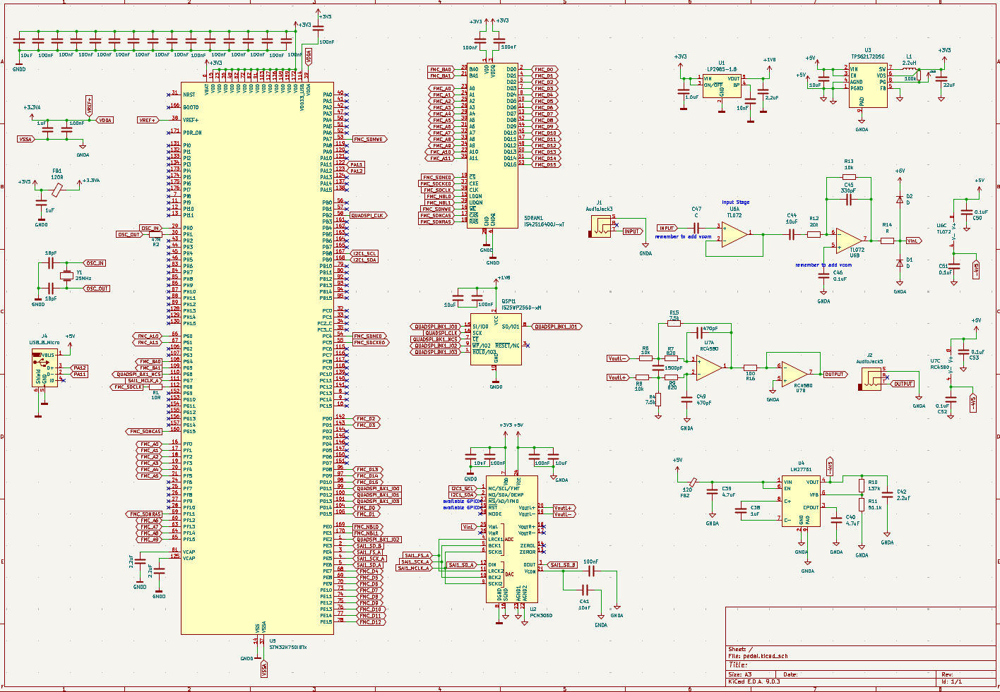

# crater

My very own multi-effects guitar pedal! Employs the STM32H750, PCM3060 audio coder-decoder, 8MB of SDRAM, and 32MB of QSPI Flash. Uses dual op amps for input (TL072H) and output (RC4580) stages.

